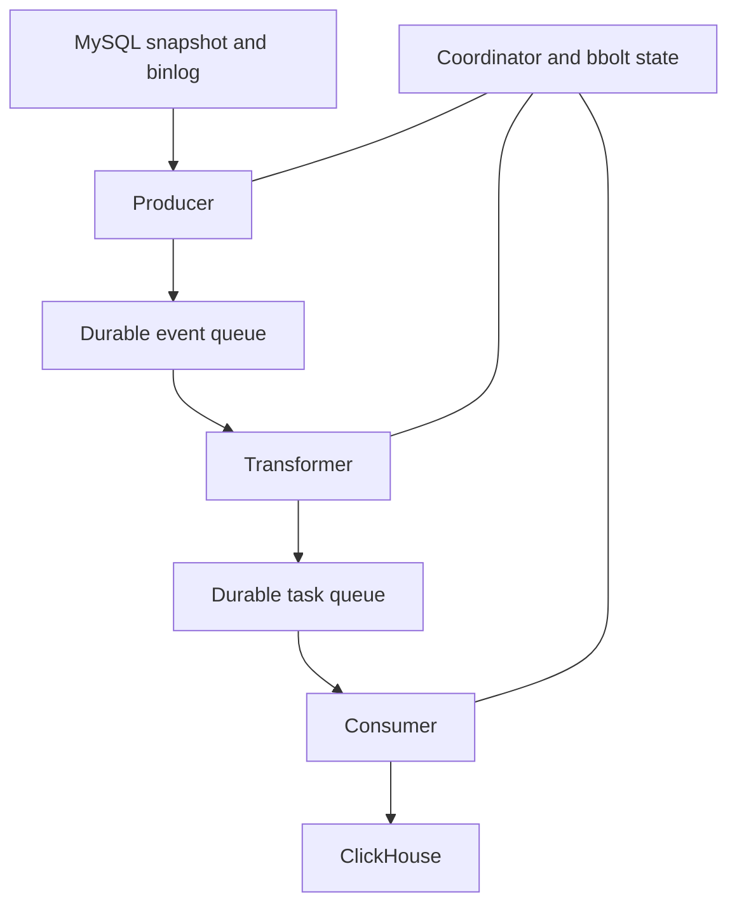

# Architecture and data guarantees

[Back to README](../README.md)



## Stage ownership

| Stage | Responsibility | Durable boundary |
| --- | --- | --- |
| Producer | Read source changes and historical DDL | Committed events and checkpoint become durable together |
| Transformer | Convert events into typed tasks | Tasks and acknowledgement of events are one journal transaction |
| Consumer | Deliver in table order | Acknowledges after execution; unresolved outcomes stay replayable |
| Coordinator | Snapshot, DDL barriers, manual operations | Operation and generation progress survive restarts |

Transformer does not write to ClickHouse. Independent tables can be delivered in parallel; each table keeps its order and DDL forms a delivery barrier. In-flight tasks are not dispatched twice by the same Consumer.

bbolt stores queues, checkpoints, schemas, version identities, snapshot progress, ownership, and operations. A journal has one writer process. Its storage must support exclusive locking; Kubernetes also needs storage fencing to prevent competing owners after a node failure.

## Delivery and identity

Transport delivery can repeat after a crash or a lost response. Tasks retain their payload, versions, and deduplication identity during retries. Versions come from persisted source ordering, not wall-clock time.

The full primary key identifies a row. A fallback key must be a configured full UNIQUE NOT NULL constraint. A key update emits a deletion marker for the old key and an insertion for the new one.

Once queues catch up, replacing-engine current-state reads converge with the supported source representation:

```sql
SELECT * FROM analytics.orders FINAL WHERE _migres_deleted = 0;
```

No automatic `OPTIMIZE FINAL` is used. Plain MergeTree is an explicit append-only mode requiring version-aware aggregation. Cross-table read atomicity is not guaranteed.

## Online snapshot

CDC starts before copying. Reads use bounded keyset pages and binlog windows; CDC versions take precedence over baseline rows. Progress is saved between completed chunks. An unfinished chunk is reread.

`auto` chooses GTID when available, otherwise a writable signal table. No global write lock or database-wide instantaneous snapshot is promised. Only InnoDB is supported. Queries and normal metadata-lock waits have timeouts.

## Schema changes

Historical rows use persisted schemas instead of current INFORMATION_SCHEMA metadata. CREATE, DROP, TRUNCATE, RENAME, column changes, and compound column ALTER statements are parsed from binlog SQL. Unsupported DDL blocks the stream.

Compatible changes apply directly. Incompatible type/key changes and ADD COLUMN with a nonconstant DEFAULT build a new generation, copy actual source values, catch up CDC, and publish through `EXCHANGE TABLES` in an Atomic database.

Name intervals distinguish a renamed table from a new table using its old name. Chained renames retain pair identities and acknowledgements. Unknown outcomes are checked against actual ownership markers before retry.

## Replication and failures

The supported topology is one shard with multiple replicas. INSERT connects to one available endpoint. Acknowledgement is `single` or configured quorum; `auto` means majority. Quorum does not imply simultaneous readability on every replica.

Keeper paths contain stable generation IDs independent of SQL names. Cluster DDL is verified on expected replicas. Exchanges inspect each endpoint and resume partial publication; switching is atomic per server.

Temporary failures retry with backoff and jitter. Permanent failures stop delivery and preserve the task. Queue and free-space thresholds apply backpressure, while history currently remains for the journal lifetime. A transaction over the staging limit does not advance its checkpoint.

Missing binlogs, unsafe schema rewinds, foreign ownership, mixed-database DDL, and combined ALTER with table rename are rejected rather than guessed. See [operations](operations.md) and [the roadmap](../ROADMAP.md).
